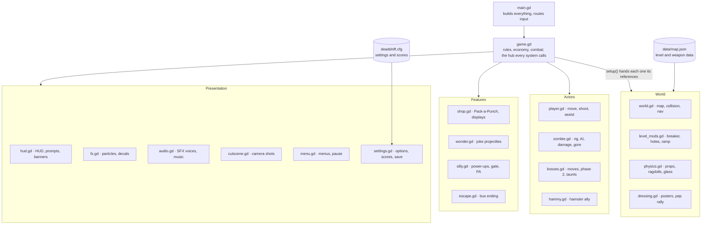

# Dead Shift: Westfield High — Game Design Document

Oct 9, 2026

## Overview

Dead Shift: Westfield High is a single-player, first-person, round-based zombie survival shooter set in an overrun American high school, played for score or for an escape. It is a Godot 4.4 port of an earlier three.js web game, rendered at half resolution for a PS2-era look.

| Item | Value |
| --- | --- |
| Genre | Wave survival FPS (Call of Duty Zombies lineage) |
| Setting | Westfield High at night: cafeteria, halls, gym, library, labs, yard, parking lot |
| Platform | Windows PC, keyboard + mouse and Xbox-layout controller |
| Engine | Godot 4.4.1, GL Compatibility renderer, Jolt physics, 60 Hz physics |
| Session | One run per life; ends on death or by buying the bus escape (30,000 points) |
| Tone | Horror-comedy: gore and dread mixed with school jokes (the Principal on the PA, a hamster ally, a trombone weapon) |

**Design pillars**

- **Every kill feels good.** Hitstop, screen shake, HUD jolts, point pops, gore and dismemberment reward each shot.
- **Spend to survive.** Points buy space (doors), power (guns, box, Pack-a-Punch) and help (Hammy, traps), and every choice costs you something else.
- **The school is the toy.** Ragdolls, glass, lockers, vending machines, barrels and a pushable bookshelf make the map react.
- **Silly, but fair.** Joke weapons, hats and power-ups sit on top of a readable, escalating wave curve.

## Core loop

A run is an endless series of waves: kill everything, earn points, spend them between and during waves, and survive as long as you can or buy your way out.

1. **Intermission** (3 s before wave 1, 8 s after each wave). Music sinks to a calm mix. Grenades refill by 2, to a cap of 4. Wonder-weapon magazines refill.
2. **Wave start.** The banner shows WAVE N. The wave's quota is `4 + 3 × wave` zombies.
3. **Spawning.** One zombie every `max(0.35, 1.7 − 0.09 × wave)` s, from one of the five nearest open spawns more than 8 m from the player. Live zombies are capped by `horde_cap()`: 24 up to wave 5, then +2 per wave to 44 (20–32 on low physics detail).
4. **Boss waves.** On every 5th wave, once 3 zombies have spawned, a boss arrives with a cutscene and its own music.
5. **Wave clear.** When the quota is spent and nothing is alive, the game shows WAVE N SURVIVED. Every 10th wave the Principal makes a PA announcement.
6. **Run end.** Death leads to the game-over screen. R or X restarts, ESC returns to the menu. Buying the bus leads to the ESCAPED ending. Both save the score and any unlocks earned.

Zombies that fall too far behind the player are relocated to a fresh spawn near them (`respawn_near`), so a wave never stalls behind a closed door.

## Player

The player is a fragile, fast survivor: 100 HP, two gun slots, a knife, and up to four grenades, with health that only comes back by staying out of harm.

| Stat | Value |
| --- | --- |
| Health | 100. Regenerates 5 HP/s after 4 s without damage |
| Walk / sprint speed | 7.0 m/s / 11.2 m/s (sprint only moving forward, not aiming or firing) |
| ADS move penalty | −35% speed |
| Jump | 7.2 m/s up, gravity 22 m/s² |
| Gun slots | 2. A new gun fills the empty slot, else replaces the held gun |
| Start loadout | Pistol, infinite reserve (start gun selectable once unlocked) |
| Grenades | Start 2, +2 per wave, max 4. 2.0 s fuse, 6 m blast |
| Field of view | 72° default (setting), +9° while sprinting |

**Combat verbs**

- **Fire / ADS.** Spread tightens 60% in ADS and grows 35% while moving. Automatic guns build bloom.
- **Knife.** 150 damage to the nearest zombie in a 2 m cone. With the bayonet rifle held it becomes a 2.8 m thrust that hits two in a line for 320 damage.
- **Kick** (melee while sprinting). 20 damage and a shove to up to 4 zombies in 2.3 m, staggering anyone near them.
- **Flashlight.** On by default, 26 m range, flickers now and then.

**Status effects on the player**

- **Slow:** −45% speed (gravy).
- **Stun:** −60% speed (the Coach's whistle).
- **Free Period:** infinite ammo.
- **Invulnerable:** scripted.

**Controls**

| Action | Keyboard + mouse | Controller |
| --- | --- | --- |
| Move / look | WASD / mouse | Left stick / right stick |
| Sprint | Shift | Click left stick (latched) |
| Jump | Space | A |
| Fire / aim | LMB / RMB | RT / LT |
| Reload | R | X (when nothing to use) |
| Use / buy | F | X |
| Grenade | G or E | RB |
| Swap gun | Q, 1, 2, wheel | Y |
| Melee | V | B or right stick click |
| Flashlight | L | D-pad up |
| Pause | Esc | Start |

Controller aim assist has four strengths: Off, Low, Normal and Strong (0 to 1.4). It combines slowdown over a target, rotational follow, a snap to the head when you press aim, and up to 2.2° of bullet magnetism. On-screen button prompts switch to whichever device you used last.

## Weapons

There are 16 guns from three sources: wall-buys (fixed price, fixed place), the mystery box (950, random), and Pack-a-Punch (5,000, needs power), which turns any held gun into a named upgrade. All stats come from `data/map.json → weapons`.

| Gun | Type | Dmg × pellets | Mag | Fire interval (s) | Pierce | Where | Upgrade name |
| --- | --- | --- | --- | --- | --- | --- | --- |
| Pistol | Semi | 25 | 12 | 0.17 | 1 | Start (infinite reserve) | Mr. Black |
| .357 Magnum | Semi | 70 | 6 | 0.45 | 2 | Wall 1,000 · box | The Judge |
| Shotgun | Pump | 17 × 9 | 6 | 0.85 | 1 | Wall 800 · box | Gravedigger |
| Sawed-Off | Break | 16 × 12 | 2 | 0.25 | 1 | Wall 900 · box | Double Trouble |
| AK-47 | Auto | 22 | 30 | 0.10 | 1 | Wall 1,200 · box | Red Hand |
| SMG | Auto | 15 | 32 | 0.065 | 1 | Wall 1,500 (two) · box | Hornet Nest |
| Bayonet Rifle | Bolt | 120 | 5 | 0.95 | 4 | Wall 1,600 · box | Last Rites |
| Marksman (DMR) | Semi, 3.2× scope | 85 | 10 | 0.32 | 3 | Wall 1,800 · box | Long Goodbye |
| Staple Cannon | Auto | 16 × 3 | 40 | 0.075 | 1 | Wall 2,000 · box | Staple Storm |
| LMG | Auto | 26 | 100 | 0.09 | 2 | Wall 3,000 · box | Iron Choir |
| Flamethrower | Stream, 7 m | 9 | 120 | 0.06 | — | Box only | Hellmouth |
| Crossbow | Explosive bolt, 4.2 m | 150 | 1 | 0.5 | 1 | Box only | Widowmaker |
| Trombone | Sonic cone | 80 | 10 | 0.62 | — | Wall 1,200 · box | Seventy-Six Trombones |
| Dodgeball Cannon | Ricochet | 95 | 6 | 0.42 | — | Wall 1,400 · box | Doublemint Dodge |
| Textbook Launcher | Arcing projectile | 240 | 4 | 0.7 | — | Box only | The Encyclopedia |
| Detention Slip | Wonder | 0 | 3 | 0.8 | — | Box only | Suspension |

Ammo at a wall-buy for a gun you already own costs half its price.

**Mystery box** (`game.gd` box state machine)

- **Cost:** 950. It rolls for 3.6 s, cycling through models with a rising note.
- **Offer:** the gun is held out for 7 s to take, then the lid closes. The roll avoids guns you already own.
- **Weighting:** the pool lists the flamethrower, crossbow and bayonet rifle twice, so they come up twice as often.
- **Moving:** after 4–8 uses (wave 2 or later), the roll ends in a severed-hand omen instead. The game shows BYE BYE, refunds the 950, and the box flies off. It lands at one of 8 spots 5 s later: bus, closet, gym, art room, library, classroom, boiler room, west hall.

**Pack-a-Punch** (`shop.gd`, upstairs lab)

- Costs 5,000 and needs power. The gun goes into the machine for 3.4 s.
- The upgraded gun does 2.2× damage, has 30% less spread, reloads 15% faster and pierces one more target. It gets a bigger magazine and reserve, a violet skin and violet tracers.

**Wonder weapons** (`wonder.gd`)

- **Textbook Launcher.** An arcing hardcover hits for 240 and staggers and knocks back. It bounces up to 2 times. Upgraded, it fires 3 books in a 10° fan.
- **Dodgeball Cannon.** The ball chains to the next visible zombie within 11 m, up to 3 chains (5 upgraded). It banks off walls and splits in two when upgraded.
- **Trombone.** A 7.5 m, 64° cone does 80 damage falling off with distance, plus stagger and shove. Three or more kills in one blast trigger SAD TROMBONE, +25 points each. Upgraded: 10 m and 80°.
- **Detention Slip.** Teleports a zombie to the open spawn farthest from you for +50. Upgraded (Suspension), it deletes the zombie as a kill. Bosses are immune.

The Staple Cannon pins killed zombies to the wall behind them. Non-lethal hits slow them for 0.6 s.

## Enemies

Six regular zombie types unlock over the first seven waves. All of them scale linearly with the wave number `w` (`zombie.gd → _stats`).

| Type | From wave | HP | Speed (m/s) | Melee dmg | Kill bonus | Behaviour |
| --- | --- | --- | --- | --- | --- | --- |
| Walker | 1 | 40 + 9w | 2.2 + 0.16w (max 5.2), ±15% | 20 + 0.8w | — | Paths to the player and swings at 1.2 m |
| Runner | 3 | 20 + 4w | 5.2 + 0.12w (max 7.6) | 12 + 0.5w | +50 | Sprinting arm style, shrieks |
| Hall Monitor | 3 (7%) | 25 + 5w | 4.6 + 0.1w (max 6.5) | 10 + 0.4w | +100 | Blows a whistle every 8–11 s in sight within 20 m, making every zombie within 24 m rush (×1.75 speed) for 5 s |
| Bloater | 4 (11%) | 1.5× walker | 0.55× walker | 26 + w | +50 | Bursts on death: 3.2 m bile blast, 15 dmg |
| Armored | 5 (≈12%) | 1.15× walker | walker | walker | +100 | Helmet (60 + 10w) and vest (90 + 12w) absorb hits. The vest takes 75% of body damage until it breaks. Explosions ignore armor |
| Spitter | 7 (≈10%) | 0.9× walker | 0.85× walker | 14 + 0.5w | +50 | Lobs acid at 4.5–21 m every 3.5–5 s (10 dmg + a 6 s acid puddle at 4 dmg/0.5 s). Strafes when close. Leaves a puddle on death |

The runner chance grows from 12% + 3% per wave to a cap of 45%.

**Damage rules**

- **Headshots** do 2.2× damage (not from explosions) and give +50 points.
- **Explosions** deal 30 + 170 × falloff × power. Bosses take half.
- Every hit staggers and knocks back. Leg hits stagger longer.

**Dismemberment and crawlers**

- An arm hit has a 35% chance to sever the arm.
- Below 60% HP a zombie may lose its legs and become a crawler (0.8–1.25 m/s, short hitbox). The chance is higher from explosions and powerful guns.
- Heavy kills (explosion, power ≥ 7, bloater, boss) gib the whole body. Headshot kills pop the head. Everything else ragdolls, and the game keeps the last 14 corpses.

**Flavour**

- 22% of walkers, runners, spitters and bloaters wear a school hat (grad cap, helmet, beanie, dunce cap, hairnet). A headshot knocks it off.
- Wounded zombies drip blood, and each type has its own moans, grunts, hisses and shrieks.

**Navigation**

- Zombies go straight at the player when a body-wide line of sight is clear. Otherwise they follow the navmesh, repathing every 0.3 s.
- They keep 0.8 m of elbow room from each other, sidestep when snagged, and step up small ledges.
- A zombie stuck for 5 s, or one that falls out of the world, respawns near the player.

## Bosses

A boss arrives on every 5th wave once 3 of that wave's zombies have spawned. Each boss is a scaled-up staff member with its own moveset, a second phase below 50% HP, taunts, and theme music.

The pick avoids repeating the last boss. The Lunch Lady has a 15% chance; otherwise it is the Coach, the Principal or the Chemistry Teacher, evenly split. Boss HP includes a ×1.2 multiplier, and bosses take half damage from explosions and are immune to stagger and the Detention Slip.

| Boss | Look | HP (w = wave) | Speed (m/s) | Dmg | Phase 2 | Music |
| --- | --- | --- | --- | --- | --- | --- |
| The Coach | Janitor model ×1.8, red cap, whistle | (1400 + 120w) × 1.2 | 1.7 + 0.04w (max 3.0) | 40 | OVERTIME: +35% speed, moves 1.6× as often | Main Event |
| The Principal | Teacher model ×1.55, glasses, paddle | (900 + 80w) × 1.2 | 1.9 + 0.03w (max 2.6) | 30 | ZERO TOLERANCE: two abilities at once | The Principal |
| The Chemistry Teacher | Teacher model ×1.5, glowing goggles, flask | (1000 + 90w) × 1.2 | 2.5 + 0.04w (max 3.3) | 22 | EXOTHERMIC: an extra wide flask after each throw | Lab Safety |
| The Lunch Lady | Lunch model ×1.75, hairnet, ladle | (1600 + 130w) × 1.2 | 1.8 + 0.03w (max 2.6) | 34 | KITCHEN'S CLOSED: permanently enraged, 4 hairnet walkers spawn | Main Event |

**Movesets**

- **Coach** (rushes you).
    - *Charge:* a 0.65 s wind-up, then a 1.25 s sprint at 2.2× speed. It flings you and deals 1.1× damage, or stuns the Coach if he hits a wall.
    - *Whistle* (every 10–13 s, within 16 m): stuns you for 1.4 s (1.9 s in phase 2) and makes the horde rush for 4 s.
- **Principal** (keeps away at 5.5 m, strafes within 10 m).
    - *Paddle swat* within 3.4 m: a big knockback.
    - *Every 7.5–10.5 s, one of three abilities:* **Assembly** (every zombie rushes for 5 s), **Hall Monitors** (3 extra walkers), or **Pop Quiz** (up to 4 nearby doorways shutter for 6 s).
    - Arrives with 2 escort walkers.
- **Chemistry Teacher** (keeps away at 8 m, strafes within 13 m).
    - *Flasks* every 1.7–2.6 s: green ones leave an acid puddle, and every third is a pink one that explodes (3.6 m).
    - *Gas grenade* every 7–9 s: a 9 s cloud, 5 dmg/0.5 s.
    - Leaves an 8 s poison cloud when she dies.
- **Lunch Lady.**
    - *Gravy ladle* every 2.2–3.2 s: 10 dmg, a slow, and a 7 s gravy puddle.
    - *Tray frisbee* every 4–5.5 s: 14 dmg.
    - *Ground pound* within 7 m: an expanding shockwave ring you jump over.
    - Enraged (2× attack rate, 1.5× speed) within 9 m of the kitchen.

**Boss kill rewards**

- +1,000 points and Max Ammo: magazines and reserves refilled, grenades to 4.
- A guaranteed 2X Points drop and a 0.12 s hitstop.
- The banner reads "<BOSS> IS DOWN."

Taunts appear every 8–15 s from a shuffled pool of five lines per boss. One-off lines play on a hit, on a special move, at half health and near death (15%).

## World

Westfield High is one two-storey map. You start outside in the rainy yard and buy your way inward and upward. Ten doors (500–1,500 each) unlock nine spawn areas. The power is off until you pull the breaker upstairs.

| Door | Cost | Opens | Spawns it adds |
| --- | --- | --- | --- |
| Clear boarded window | 500 | Yard → classroom side | — |
| Open front doors | 750 | Yard → cafeteria and lobby | 4 |
| Open west hallway | 1,000 | Cafeteria → west hall, gym | 3 |
| Open east hallway | 1,000 | Cafeteria → east hall | 1 |
| Open art room | 1,250 | East hall → art room | 3 |
| Open classroom | 1,250 | East hall → classroom (Hammy) | 2 |
| Open stairwell | 1,250 | Ground floor → stairwell | 1 |
| Open second floor (east) | 1,500 | Stairwell → upstairs: lab, offices, boiler room | 4 |
| Open second floor (west) | 1,250 | Gym balcony → upstairs west: library | 2 |
| Open gym doors | 1,500 | Gym → parking lot (shock gate) | — |

The yard always has 8 spawns. The "Opens" column is worked out from door and spawn coordinates in `map.json`; confirm it in the editor.

**Power** (`level_mods.gd`, boiler room upstairs)

- Pulling the breaker gives +500 points and plays a cutscene in which the lamps come back on one by one, nearest the breaker first.
- Power is needed for Pack-a-Punch, Pack-a-Punching Hammy, and the shock gate.
- Without power, indoor lamps glow at emergency level and 30% are dead. Outdoor lamps are always on.

**Level changes made in code** (`level_mods.gd`, `dressing.gd`)

- **Upstairs:** two doorways knocked through the walls.
- **Gym:** a hole in the balcony floor with a rubble ramp up from the bleachers.
- **Decoration:** posters, pep-rally banners, balloons you can shoot, lunch trays, a menu board and papers.
- **Weather:** rain that stops under roofs, fires, light shafts, lightning every 9–22 s, and fog from 6 to 34 m.

**Physical interactables** (`physics.gd`)

- Ragdoll corpses, loose chairs, bins and cans.
- Breakable glass, lockers that bang open, and a vending machine that spills cans.
- Fire extinguishers that rocket around, swinging pendant lamps, and ceiling tiles that drop in blasts.
- A library bookshelf you can push across a doorway to block it.
- Six explosive barrels: 45 HP, a 5.5 m blast, and they chain into each other.

## Economy and progression

Points are the only currency. You start a run with 500 and earn more from hits, kills, streaks and bosses. Every purchase competes with saving 30,000 for the bus.

**Earning** (2X Points doubles everything for 20 s)

| Source | Points |
| --- | --- |
| Non-lethal hit (bullet, melee, explosion, Hammy bite) | 10 |
| Kill | 100 |
| Headshot kill | +50 |
| Special kill: runner, bloater or spitter / armored or Hall Monitor | +50 / +100 |
| Multi-kill within 0.3 s (double, triple, multi, massacre) | 50 × n × (n − 1) |
| Combo: kills chained within 2.6 s of each other | 10 × n × (n − 1), max 2,500 |
| Collateral: one bullet, two or more kills | 50 per kill |
| Detention Slip use / Suspension kill | 50 |
| Sad Trombone (3+ kills in one blast) | 25 per kill |
| Pull the power breaker | 500 |
| Boss kill | 1,000 + Max Ammo + 2X drop |

**Spending**

| Item | Cost |
| --- | --- |
| Doors | 500–1,500 (total 11,250 for all ten) |
| Wall-buys | 800–3,000 gun, half that for ammo |
| Mystery box | 950 per roll |
| Feed Hammy | 500 × 3 |
| Shock gate | 1,000 per 30 s use, 60 s cooldown |
| Pack-a-Punch (gun or Hammy) | 5,000 |
| Bus escape | 30,000 |

**Drops from kills**

- **Power-up (1.3%):** Snow Day, Fire Drill or Free Period.
- **2X Points (2.5%).**
- **Health kit (4.5%):** +30 HP.
- Only one of each power-up can be on the ground at once. Drops last 15 s and blink before they vanish.

**Power-ups** (`silly.gd`)

- **Snow Day:** freezes every zombie for 5 s. They can still be shot.
- **Fire Drill:** every zombie walks away from you for 6 s.
- **Free Period:** infinite ammo for 10 s and a full magazine.

**Long-term unlocks** (`settings.gd`, saved to `user://deadshift.cfg`)

| Unlock | Requirement |
| --- | --- |
| .357 Magnum start | Reach wave 5 |
| Rotten Zombies skin | Reach wave 8 |
| Sawed-Off start | Reach wave 10 |
| Red-Eyed Zombies skin | 250 kills all time |

## Special systems

Four set pieces give the map its personality: a hamster ally, an electric trap, PA jokes, and a win condition.

**Hammy the class hamster** (`hammy.gd`, ground-floor classroom)

- **Freeing him:** feed him three times at 500 each. After the third feeding he breaks out of his cage, and the banner reads HAMMY IS FREE.
- **Following:** he trails you and targets the nearest zombie within 8 m of you.
- **Biting:** a leg bite every 0.42 s for 22 + 5w damage (35% against bosses), +10 points per non-lethal bite.
- **Leash:** if he falls 15 m behind, or a floor away, for 1.2 s, he pops up at your heels.
- **Mega Hammy:** while he is free, look at him near Pack-a-Punch and pay 5,000. He becomes HAMSTER OF THE APOCALYPSE: twice the size and glowing violet. He bites 3× harder and faster, moves 40% faster, and each bite arcs to a second zombie within 6 m for half damage. Mega kills give +50.

**Shock Gate** (`silly.gd`, gym → parking lot doorway)

- Costs 1,000, needs power, and runs for 30 s, then needs 60 s to cool down. A lamp on the lever shows the state: green ready, blue live, red cooling, dark without power.
- **Zombies:** any zombie in the doorway is killed and charred black. Bosses take 7% max HP per zap instead.
- **Player:** you take 14 damage per 0.6 s and are thrown back out of the doorway.

**PA announcements** (`silly.gd`)

- After waves 10, 20, 30 and so on, a chime plays, then a captioned line from the Principal.
- There are eight lines, which loop after wave 80.

**The bus escape** (`escape.gd`, parking lot bus)

1. With 30,000 points, use the bus door: "Press F to hotwire the bus and escape." The player is invulnerable from here on.
2. A six-shot cutscene plays: climb aboard, the engine coughs and roars, a horde of 16 swarms the bus, the bus ploughs toward the gates, smashes them in slow motion (0.3×), and drives into the night.
3. The ESCAPED screen shows wave, kills, points and run time. It records an escape badge, best escape points and fastest escape, kept separate from best wave.
4. After 9 s, or any input, the game returns to the main menu.

The save records `escaped_from = "westfield"`, a hook for linking maps later.

## Presentation

The target is a PS2-era horror shooter with arcade-style punch. Visuals are chunky and low resolution, the HUD looks painted and loud, and every hit gets layered feedback.

**Art direction** (`main.gd`, `world.gd`)

- **Resolution:** 3D renders at half resolution (Pixel setting 1–3) and is scaled up with nearest-neighbour. The HUD renders into its own half-resolution layer so the type is chunky too.
- **Shading:** nearest-filtered textures, Lambert shading, no specular, linear tonemap, light glow, contrast 1.08, saturation 0.9.
- **Night mood:** dark blue ambient light, depth fog from 6 to 34 m, rain and lightning flashes.
- **Light:** a flickering flashlight is the main light source until the power comes on.
- **Models:** 20 exported zombie models posed in code (lean, sway, arm styles), and blocky first-person guns with hand and sleeve.

**HUD** (`hud.gd`)

- **Fonts:** Black Ops One for numbers and banners, VT323 for text. Labels sit on tilted red boxes. Scanlines and a vignette cover the screen.
- **Top left:** wave number and health bar with a trailing ghost bar.
- **Top right:** points, which pop and send +N flying off.
- **Bottom right:** gun name, ammo, grenades.
- **Other elements:** an interaction prompt with keyboard-or-Xbox button badges, banners, callouts, the combo counter with its timer bar, the boss health bar, "now playing" track titles, cutscene letterboxing, and the game-over and ESCAPED screens.

**Juice** (`game.gd`, `fx.gd`)

- **Hitstop:** time drops to 3% speed for 45 ms on a headshot, 50 ms on melee, 70 ms on a nearby explosion, 120 ms on a boss kill.
- **Shake and jolts:** screen shake, controller rumble and HUD jolts scale with the event.
- **Blood:** instanced sprays with streaks, exit spurts and mist; floor and wall splats; blood that stays on props.
- **Debris:** bouncing gibs, ejected casings and shells, tracers (violet when upgraded), scorch marks, and electric arcs.

**Audio** (`audio.gd`)

- Positional SFX with per-sound voice caps (2 for gunshots), so automatic fire doesn't stack up and phase.
- Music loops follow the run: Night School (waves 1–3), Detention (4–7), Last Bell (8+), plus the boss themes. Between waves a 900 Hz low-pass muffles the music.
- Zombie voices come in four timbres and are pitched per zombie. There is ambience, PA chimes, and the Principal's voice.

**Cutscenes** (`cutscene.gd`)

- Camera moves follow lines or Catmull-Rom paths. The game freezes underneath and any key skips; events that were skipped still run.
- **Scenes:**
    - *Infection prologue*, once per launch: students still human, then bitten.
    - *Intro fly-in*: "WESTFIELD HIGH — THE NIGHT THE LAST BELL NEVER RANG".
    - *Boss entrance*: 3.4 s with name and subtitle.
    - *Power on*: four shots across the school.
    - *Bus escape*: six shots.

## Meta

Outside a run, the game is a main menu over a slow fly-through of the school, with four pages and one save file.

**Flow:** first launch shows the infection prologue, then the main menu. PLAY starts the intro fly-in and wave 1 three seconds later. ESC pauses. After game over, R restarts straight into a run and ESC returns to the menu.

| Page | Contents |
| --- | --- |
| Main | Play · Map: Westfield High · Bunker 9 (coming soon, disabled) · Loadout and unlocks · Settings · Quit |
| Pause | Resume, Settings, Quit to menu, Quit game |
| Settings | Mouse sensitivity 0.2–3.0 · controller look 0.3–2.5 · aim assist Off/Low/Normal/Strong · stick deadzone 0.03–0.35 · FOV 60–100 · master, music, effects volume · PS2-ness Crisp/PS2/Crunchy · physics detail Low/Normal · invert Y · fullscreen |
| Unlocks and records | Starting gun (Pistol, .357 Magnum, Sawed-Off) · zombie skin (Normal, Rotten, Red-Eyed) · best wave, kills, points, total kills, games, escapes, best escape points, fastest escape |

**Save data:** `user://deadshift.cfg`, which is `%APPDATA%\Godot\app_userdata\Dead Shift- Westfield High`. It has a `[settings]` section and a `[scores]` section. Unlocks are not stored; they are worked out from the scores.

Menus follow the last device used: hints read "A select · B back" on a controller or "ENTER select · ESC back" on a keyboard, and the left stick moves focus.

## Technical overview

The game is about 10,700 lines of GDScript in 22 files, all built at runtime from one empty scene. There are no autoloads: `main.gd` builds the viewports and core nodes, `game.gd` builds and wires every other system, and all tuning data comes from `data/map.json`.

`main.gd` creates `game.gd`, which hands each subsystem its references at setup. Level data feeds the world, and the save file feeds settings. `tests3.gd` (test sections) and `guns.gd` (static gun-model builder) sit outside the diagram.

**Low-level designs**

| LLD | Covers |
| --- | --- |
| [LLD-01 Architecture and boot](LLD-01-Architecture-and-boot.md) | Boot order, node tree, game states, input routing, collision layers, cross-system contracts |
| [LLD-02 Game rules](LLD-02-Game-rules.md) | Wave loop, spawning, interact priority, combat helpers, combos, grenades, barrels, pickups, mystery box |
| [LLD-03 Player and weapons](LLD-03-Player-and-weapons.md) | Movement, look, slots, fire pipeline, aim assist, melee, gun models, wonder weapons, Pack-a-Punch |
| [LLD-04 Zombies and bosses](LLD-04-Zombies-and-bosses.md) | Zombie rig and hitboxes, damage pipeline, AI and navigation, special types, boss movesets |
| [LLD-05 World, navigation and physics](LLD-05-World-navigation-and-physics.md) | Map build, navmesh rebakes, doors, lighting and power, level mods, physics props, ragdolls |
| [LLD-06 Presentation systems](LLD-06-Presentation-systems.md) | HUD, FX particle pool and decals, audio voice caps and music, cutscenes, menus, settings |
| [LLD-07 Set pieces](LLD-07-Set-pieces.md) | Hammy, power-ups, Shock Gate, PA, bus escape |
| [LLD-08 Data, build and tests](LLD-08-Data-build-and-tests.md) | `map.json` schema, weapon fields, save file, export preset, test modes |

**Open questions**

- The export preset embeds the pck (`embed_pck = true`), but the shipped zip uses a separate `DeadShift.pck` next to a stock Godot exe. Pick one.
- Door adjacency in the World section is worked out from coordinates. Confirm it against the map in the editor.
- The main menu lists BUNKER 9 (COMING SOON), and the escape save stores `escaped_from`. Is a second map planned, and how would the bus link to it?
