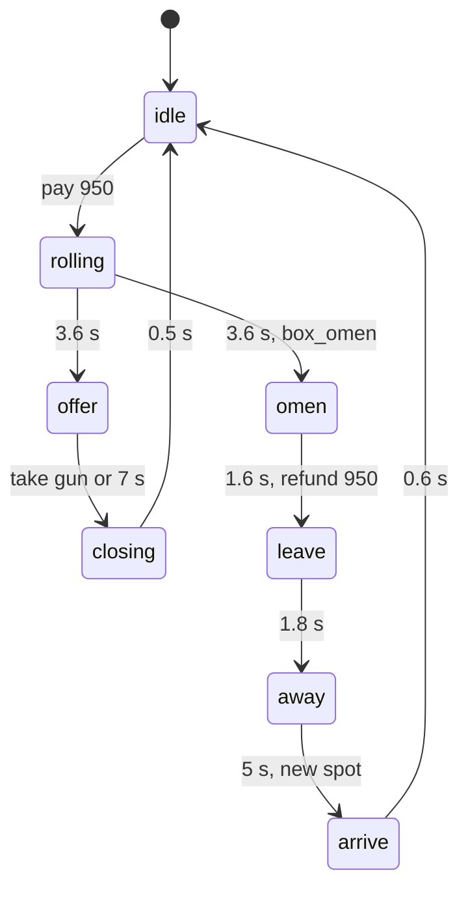

# LLD-02 Game rules

Part of the [Dead Shift game design document](GDD.md). File and line references point at `DeadShift/scripts/` as of 2026-10-09.

`game.gd` (1,844 lines) owns the run: wave flow, spawning, the economy, every interactable prompt, and the shared combat helpers (hitscan, flame, explosions, melee). It also runs the short-lived world objects: grenades, barrels, pickups, spit, gravy, flasks and shutters.

## Run state

| Field | Default | Meaning |
| --- | --- | --- |
| `points` | 500 | Currency |
| `wave` | 0 | Current wave (0 before wave 1) |
| `to_spawn` / `spawned_this_wave` | — | Quota remaining / spawned so far this wave |
| `spawn_t` / `inter_t` | 0.8 / 3.0 | Countdown to the next spawn / to the next wave |
| `open_areas` | `{yard: true}` | Door ids bought; filters spawns |
| `zombies`, `corpses` | [] | Live list; last 14 corpses |
| `grenades` | 2 | Capped at `MAX_NADES` = 4 |
| `x2_t`, `combo_n/t`, `mk_n/t` | 0 | 2X timer, combo chain, multi-kill window |
| `boss`, `boss_spawned`, `last_boss` | — | Boss bookkeeping |
| `run_t`, `kills`, `respawns` | 0 | Stats |

## Per-frame order (`_process`, `game.gd:1526`)

1. Restore `Engine.time_scale` once `hitstop_until` has passed.
2. `cutscene` state: world look plus HUD only, then return.
3. Step projectiles, grenades, the barrel chain queue, pickups, shutters and flasks. Update the boss bar. Tick the box. Advance the grenade cooldown. Update the world look.
4. `stage` or `menu` state: HUD, then return.
5. Tick `x2_t` and `run_t`, then the combo and multi-kill timers.
6. `inter`: count down `inter_t`, then `start_wave()`.
7. `play`: spawn when `to_spawn > 0`, `spawn_t ≤ 0` and alive < `horde_cap()`. Set `spawn_t = max(0.35, 1.7 − 0.09w)`. If `w % 5 == 0`, no boss yet and 3 or more spawned this wave, call `spawn_boss()`. When the quota is spent and nothing is alive, switch to `inter` (8 s), and call `silly.pa()` on every 10th wave.
8. Music: the boss track if a boss is alive, otherwise Night School for waves up to 3, Detention up to 7, then Last Bell. Low-pass (calm) when not in `play` or with no zombies.
9. Lightning every 9–22 s. `interact_target = _find_interact()`. `hud.update()`.

## Spawning

- `_pick_spawn(near)`: take open-area spawns more than 8 m from `near` (falling back to all open spawns), sort by distance, and pick one of the nearest five at random.
- `_pick_kind()` checks in order:
    1. wave ≥ 4 and r < 0.11: bloater
    2. wave ≥ 5 and r < 0.23: armored
    3. wave ≥ 7 and r < 0.33: spitter
    4. wave ≥ 3 and a new roll < 0.07: monitor
    5. wave ≥ 3 and a new roll < min(0.12 + 0.03w, 0.45): runner
    6. otherwise walker
- `horde_cap()` = `clamp(24 + 2(w − 5), 24, 44)`, or `clamp(20 + (w − 5), 20, 32)` when `physics.detail < 1`.
- `respawn_near(z)` moves a stuck or lost zombie to a fresh spawn more than 7 m from the player with `emerge = 1.3`.

## Interactables

`_find_interact()` runs every frame and returns the first match in priority order, as `{kind, def?, text}`. `{use}` in `text` is replaced by a key or pad badge in the HUD.

| Priority | Kind | Condition |
| --- | --- | --- |
| 1 | `door` | Closed door, within 2 m (horizontal) and 1.6 m (vertical) of any of its `spots` |
| 2 | `gun` / `ammo` | Within 1.8 m of a wall-buy spot. `ammo` if already owned |
| 3 | `hampap` | Hammy free, looked at within 35°, near PaP, powered |
| 4 | `pap` | Within 1.8 m of `shop.PAP_SPOT` |
| 5 | `power` | `level.prompt()` (breaker, not yet powered) |
| 6 | `bus` | Within 2.4 m of the bus door |
| 7 | `gate` | Shock gate lever |
| 8 | `shelf` | Within 1.5 m of the bookshelf footprint |
| 9 | `hamster` | Feed spot, fed < 3 |
| 10 | `box` | Box `idle` or `offer`, within 1.6 m of `_box_front()` |

`interact()` checks points (`_deny()` plays a sound, shows NOT ENOUGH POINTS and jolts the HUD), subtracts the cost, and runs the effect. A door adds to `open_areas` and calls `world.open_door(id)`, which tweens the meshes away, frees the barriers and rebakes the navmesh.

## Combat helpers

- `shoot_ray(origin, dir, wd)`: up to 10 ray segments, mask `1|4|16|32`, areas on. Hitting a zombie hitbox calls `z.damage`, then excludes all of that zombie's boxes and decrements `pierce`. Balloons and glass are passed through. Rigid bodies, lockers, lamps and extinguishers take a physics shot and stop the ray. Vending machines spill cans. Walls get a spark and a bullet hole, and a 15% ricochet sound. Barrels take damage. Crossbow bolts `explode()` on impact. Returns `{end, hit, kill}` and awards COLLATERAL for 2 or more kills with a single-pellet gun.
- `flame(origin, dir, wd)`: a cone (dot > 0.9) within `wd.range` with line of sight. Barrels take half damage.
- `explode(at, radius, power, bile)`:
    - **Effects:** FX, sound, a physics blast, hitstop within 30 m, shake, rumble and HUD jolt.
    - **Zombies:** each in range takes `(30 + 170(1 − d/r)) × power` with `blast = true`.
    - **Barrels:** those in range are queued to chain after 0.12–0.3 s.
    - **Player:** knocked back and takes `8 + 50(1 − d/r)`, halved for bile.
- `melee(origin, dir, kind)`: `knife` hits 1 zombie in 2 m for 150. `bayo` hits 2 in 2.8 m for 320. `kick` hits up to 4 in 2.3 m for 20 with a 9 m/s shove and splash stagger. The cone is dot > 0.5. Barrels take 20.

## Kill, combo and multi-kill

- `on_zombie_killed`: `kills++`, `add_points(100 + 50·head + bonus)`, removes the zombie from the list, starts the multi-kill window (`mk_t = 0.3`), adds to the combo (`combo_t = 2.6`), and hitstops 0.045 s on a headshot. Drop rolls, in order: `silly.maybe_drop` (1.3%), then 2X (2.5%), then health (4.5%).
- Multi-kill pays when `mk_t` expires with `mk_n ≥ 2`: `50·n·(n − 1)` and a DOUBLE, TRIPLE, MULTI KILL or MASSACRE callout.
- Combo pays when `combo_t` expires with n ≥ 2: `min(2500, 10·n·(n − 1))`. A combo-up sound plays every 5 kills.
- `add_points(n)` doubles while `x2_t > 0`.

## Grenades and barrels

- **Grenade:** `throw_nade()` needs `play` or `inter`, a grenade in stock and `nade_t ≤ 0` (0.7 s cooldown). Velocity is `look × 14 + (0, 3.5, 0) + 0.4 × player horizontal velocity`. The fuse is 2.0 s and it beeps for the last 1.2 s.
- **Grenade physics:** gravity 20, swept ray collisions. Floor bounces keep 0.65 of horizontal speed and 0.38 of vertical. Walls reflect at 0.4. It rolls with friction and comes to rest. Detonation is `explode(at, 6.0, 1.1)`.
- **Barrels:** 6 fixed positions (`BARRELS`), static bodies on WORLD under `Nav`, snapped to the floor after two physics frames, then a rebake. 45 HP. `explode_barrel` throws 7 shards, frees the body, rebakes and calls `explode(c, 5.5, 1.0)`.

## Pickups

Record fields: `{n, type, life, y}`. Types and lifetimes:

- `ammo`: 25 s, +1 magazine to the held gun's reserve.
- `health`: 15 s, +30 HP if hurt.
- `x2`: 15 s, only one at a time, starts `x2_t = 20`.
- `pw_snow`, `pw_drill`, `pw_free`: 15 s, call `silly.activate`.

Pickups bob and spin, are collected within 1.3 m (horizontal) and 1.5 m (vertical), and blink when `life < 4`.

## Mystery box

**States:** `idle → rolling (3.6 s) → offer (7 s) → closing (0.5 s) → idle`. When `box_omen` is set: `rolling → omen (1.6 s) → leave (1.8 s) → away (5 s) → arrive (0.6 s) → idle`.

**Rolling:**

- `_box_roll()` increments `box_uses`.
- `box_omen = uses ≥ box_move_at (4–8) and wave ≥ 2 and more than 1 box spot`.
- The result is drawn from the pool minus guns you own (the full pool if that leaves nothing). The omen result is `""`.
- The displayed model cycles every `0.06 + 0.3k²` s (k = t / 3.6), never repeating the previous one, with a rising note.

**Omen and move:**

- The omen refunds 950 and shows the hand.
- `leave` lifts and spins the box away, then hides it and turns off its collision.
- `away` picks a different spot, resets `box_uses` and rerolls `box_move_at`.
- `arrive` drops the box in from 4 m and turns collision back on.

**Taking the gun:** `_box_take()` gives the gun with `box_reserve` ammo.

**Lid, glow, beam and light** are animated from the state each frame.
